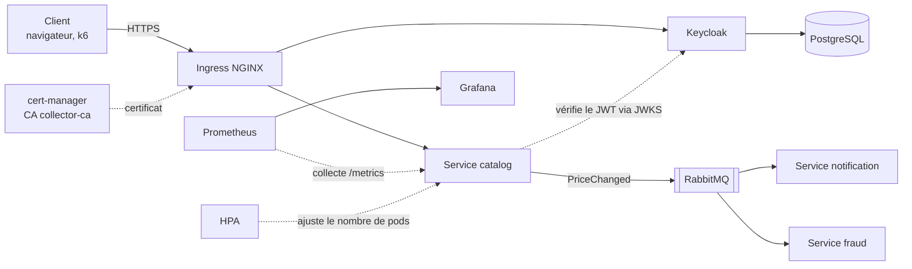

# Protocole d'expérimentation — Bac à sable

Quatre expériences, menées du 06/11 au 25/11/2026 sur le poste du Lead dev, ont validé les technologies critiques de l'architecture avant le développement : **toutes ont été adoptées**.
Le détail reproductible (fichiers, commandes, sorties) est dans le README de chaque dossier `sandbox/`.

## 1. Synthèse des expériences

| # | Technologie testée | Preuve apportée | Résultat | Décision |
|---|---|---|---|---|
| 1 | [Ingress NGINX + cert-manager](../sandbox/01-tls-cert-manager/README.md) | Un service exposé en HTTPS avec un certificat émis automatiquement par la CA du projet, vérifié sans option « insecure » | `HTTP 200`, vérification TLS `0` | Adoptée |
| 2 | [Keycloak + PostgreSQL](../sandbox/02-keycloak/README.md) | Jetons JWT avec rôles métier ; une API vérifie signature, émetteur, audience et rôle | 7 / 7 scénarios (200 / 401 / 403, jeton falsifié refusé) | Adoptée |
| 3 | [RabbitMQ](../sandbox/03-rabbitmq/README.md) | Un événement reçu par deux consommateurs ; **aucune perte quand un consommateur est arrêté** | 10 / 10 contrôles, alerte de fraude récupérée au redémarrage | Adoptée |
| 4 | [Prometheus + Grafana + HPA + k6](../sandbox/04-observability-hpa/README.md) | Métriques collectées, tableau de bord, autoscaling 1 → 4 → 1 pod sous charge | 4 / 4 contrôles ; p95 191 et 256 ms, 0 % d'erreur | Adoptée |

## 2. Environnement de test

| Élément | Valeur |
|---|---|
| Poste | Windows 11 Home 25H2, 16 Go RAM |
| Conteneurs | Docker Desktop (moteur 29.9.2), backend WSL2 limité à 10 Go / 8 CPU (`.wslconfig`) |
| Cluster | Minikube 1.39.0, profil `collector-poc` (pilote docker, 4 CPU, 7 Go), Kubernetes 1.37.0, containerd 2.3.4 |
| Outils | kubectl 1.37.2, Helm, addons `ingress` et `metrics-server` |
| Isolation | Un namespace par expérience (`sandbox-tls`, `sandbox-auth`, `sandbox-mq`, `sandbox-obs`) |
| Secrets | Générés aléatoirement par script dans des Secrets Kubernetes, jamais écrits dans Git |

## 3. Interactions entre les briques validées

Chaque expérience a validé une interaction de l'architecture cible ; le développement du POC les assemble.

| Interaction | Validée par |
|---|---|
| Ingress ↔ cert-manager (certificat automatique) | Expérience 1 |
| Keycloak ↔ PostgreSQL ; API ↔ Keycloak (JWKS) | Expérience 2 |
| Éditeur ↔ RabbitMQ ↔ 2 consommateurs | Expérience 3 |
| Prometheus ↔ API (ServiceMonitor) ; HPA ↔ metrics-server ; Grafana ↔ Prometheus | Expérience 4 |
| Keycloak exposé en HTTPS par l'Ingress avec un certificat `collector-ca` | Expériences 1 + 2 |
| **Ensemble des briques dans une même application** | À démontrer par le POC (phase 2.3) |

## 4. Difficultés rencontrées

| # | Difficulté | Cause | Résolution |
|---|---|---|---|
| 1 | Mémoire Docker insuffisante | WSL2 limite Docker à 50 % de la RAM | `.wslconfig` : 10 Go, 8 CPU |
| 2 | Risque d'incompatibilité | Minikube 1.37 (Kubernetes ancien) face à kubectl 1.37 | Mise à jour de Minikube en 1.39 |
| 3 | Avertissement « registry.k8s.io inaccessible » | Test de minikube exécuté trop tôt | Faux positif prouvé (`curl` depuis le nœud : HTTP 307) |
| 4 | `HTTP 503` lors de la vérification HTTPS | Test lancé avant que le pod soit prêt | Sonde `readinessProbe`, attente `rollout status`, `curl --retry` |
| 5 | Grafana arrêté en boucle (`OOMKilled`) | Limite mémoire de 256 Mi trop basse | Limite portée à 512 Mi, réinstallation de la release Helm |
| 6 | p95 serveur (≤ 60 ms) ≠ p95 client (256 ms) | Le serveur ne mesure pas l'attente avant traitement | L'indicateur 5 se mesure côté client (k6) |

## 5. Limites et choix écartés

**Limites assumées du bac à sable** : un seul nœud (pas de haute disponibilité), CA auto-signée, charge générée depuis la même machine, mesures variables d'une exécution à l'autre (comparer sur plusieurs exécutions).

| Option écartée | Raison |
|---|---|
| Images et charts Bitnami (RabbitMQ, PostgreSQL) | Accès gratuit restreint depuis 2025 : dépendance jugée risquée ; images officielles retenues |
| Keycloak en mode `dev` (base intégrée) | Non représentatif de la production ; mode `start` sur PostgreSQL retenu |
| Grant OAuth « password » pour l'application | Réservé aux tests automatisés ; le front utilisera *authorization code + PKCE* |

## 6. Constats reportés au plan d'amélioration

- RabbitMQ : ajouter une file de lettres mortes et rendre les consommateurs idempotents (dédoublonnage par `eventId`).
- Charge : un pod sur quatre quasi inactif (hypothèse : connexions *keep-alive* réparties par connexion) ; capacité maximale atteinte sur ce poste (pods à leur limite CPU, HPA à 4).
- Production : remplacer la CA auto-signée par Let's Encrypt, répliquer Keycloak et RabbitMQ.
