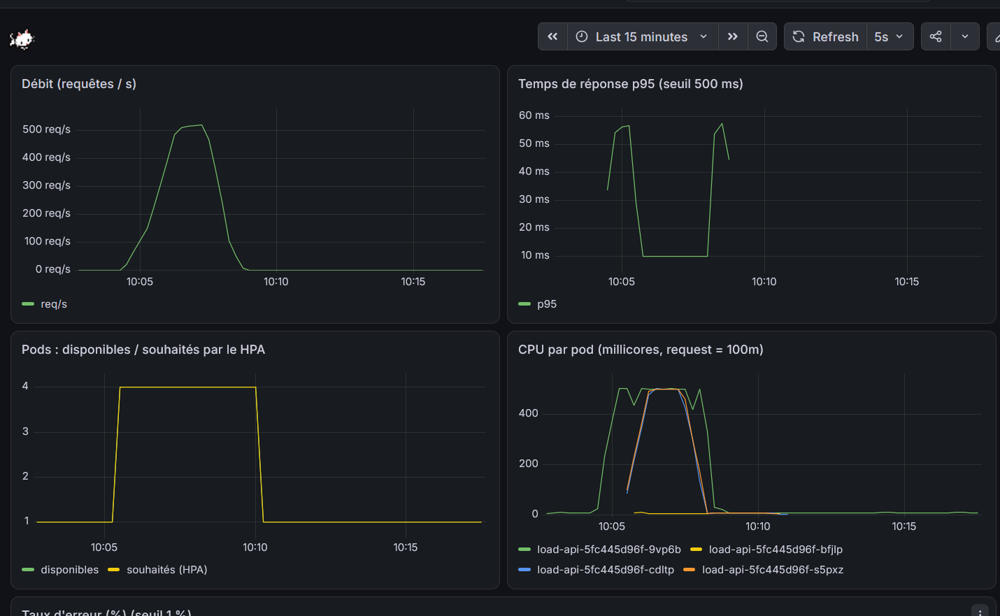
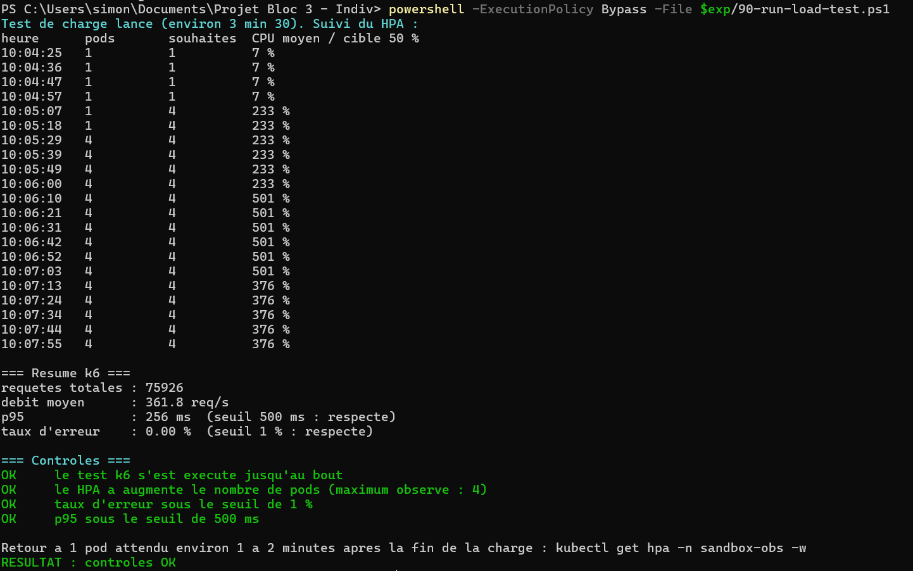

# Expérience 4 — Observabilité et montée en charge (Prometheus, Grafana, HPA, k6)

## Objectif
Prouver que :
1. **Prometheus** collecte automatiquement les métriques d'une API (débit, temps de réponse, CPU des pods) ;
2. **Grafana** les affiche dans un tableau de bord versionné dans Git ;
3. sous une charge **k6**, le **HPA** (Horizontal Pod Autoscaler) **ajoute des pods** puis revient à 1 pod quand la charge retombe ;
4. l'indicateur qualité n° 5 (p95 < 500 ms, erreurs < 1 %) est **mesurable**.

C'est la répétition générale du test de charge demandé en soutenance.

## Ce qui est déployé
| Fichier | Contenu |
|---|---|
| `00-namespaces.yaml` | `monitoring` (pile d'observabilité, conservée pour l'application) et `sandbox-obs` (expérience) |
| `01-create-secrets.ps1` | Mot de passe administrateur Grafana aléatoire dans un Secret (rien dans Git) |
| `10-monitoring-values.yaml` | Valeurs Helm de **kube-prometheus-stack** allégées pour Minikube (sans Alertmanager ni node-exporter) |
| `20-load-api.yaml` | API de test Node.js instrumentée (`prom-client`) : `/work` consomme du CPU, `/metrics` expose les métriques ; **ServiceMonitor** (collecte toutes les 5 s) |
| `30-hpa.yaml` | HPA : 1 à 4 pods, cible 50 % de CPU ; retour à la baisse après 60 s de stabilité |
| `40-dashboard.yaml` | Tableau de bord Grafana : débit, p95, pods disponibles / souhaités, CPU par pod, taux d'erreur |
| `50-k6-job.yaml` | Scénario k6 : montée à 40 utilisateurs virtuels (1 min), palier (2 min), descente (30 s) ; seuils de l'indicateur 5 |
| `90-run-load-test.ps1` | Lance k6, suit le HPA toutes les 10 s, affiche le résumé et les contrôles |

## Étapes (PowerShell, depuis la racine du dépôt)
```powershell
kubectl config use-context collector-poc
$exp = 'sandbox/04-observability-hpa'

# 0. Libérer la mémoire (expériences 1 à 3 terminées et documentées)
kubectl delete namespace sandbox-auth sandbox-mq sandbox-tls

# 1. Namespaces + secret Grafana
kubectl apply -f $exp/00-namespaces.yaml
powershell -ExecutionPolicy Bypass -File $exp/01-create-secrets.ps1

# 2. Pile d'observabilité (Prometheus, Grafana, kube-state-metrics, opérateur)
helm install monitoring oci://ghcr.io/prometheus-community/charts/kube-prometheus-stack `
  --version 93.9.0 --namespace monitoring -f $exp/10-monitoring-values.yaml --wait --timeout 10m
helm list -n monitoring

# 3. API de test, HPA, tableau de bord
kubectl apply -f $exp/20-load-api.yaml -f $exp/30-hpa.yaml -f $exp/40-dashboard.yaml
kubectl rollout status -n sandbox-obs deployment/load-api --timeout=180s
```

### Ouvrir Grafana (dans un **second** terminal, à laisser ouvert)
```powershell
kubectl port-forward -n monitoring svc/monitoring-grafana 3000:80
```
- Adresse : http://localhost:3000 — identifiant `admin`
- Mot de passe :
```powershell
[Text.Encoding]::UTF8.GetString([Convert]::FromBase64String((kubectl get secret grafana-admin -n monitoring -o "jsonpath={.data.admin-password}")))
```
- Tableau de bord : *Dashboards* → **Collector — Expérience 4 : montée en charge**

### 4. Lancer le test de charge (premier terminal)
```powershell
powershell -ExecutionPolicy Bypass -File $exp/90-run-load-test.ps1
```
Observer en parallèle le tableau de bord Grafana (rafraîchi toutes les 5 s).

## Résultat attendu
- Le suivi affiche le nombre de pods qui passe de **1 à 2, 3 ou 4** pendant le palier.
- Contrôles `OK` : test exécuté jusqu'au bout, HPA déclenché, taux d'erreur < 1 %.
- p95 : `OK` si < 500 ms, sinon `INFO` → **axe d'amélioration à documenter** (c'est l'objectif de l'indicateur 5, pas un échec de l'expérience).
- Dans Grafana : hausse du débit et du CPU, puis apparition de nouveaux pods et baisse du CPU par pod.

## Limites assumées (bac à sable)
- Minikube = un seul nœud de 4 CPU : la montée en charge est limitée par la machine, pas par l'application.
- La charge est générée **depuis le cluster** (même machine) : elle consomme une partie du CPU mesuré.
- Le HPA réagit avec un délai (collecte des métriques toutes les 15 s environ) : un pic très bref n'est pas absorbé.

## Nettoyage
```powershell
kubectl delete namespace sandbox-obs
kubectl delete configmap dashboard-sandbox-load -n monitoring
```
(La pile `monitoring` est conservée pour l'application.)

## Difficulté rencontrée (1re exécution)
L'installation Helm a échoué (`monitoring-grafana not ready`) : le conteneur Grafana était arrêté en boucle (`CrashLoopBackOff`, motif **`OOMKilled`**, code 137) car sa limite mémoire (256 Mi) était trop basse pour la version récente de Grafana.
Diagnostic : `kubectl describe pod` (motif OOMKilled) puis `kubectl logs`. Correction : limite portée à 512 Mi dans `10-monitoring-values.yaml`, désinstallation puis réinstallation de la release.
Prometheus, l'opérateur et kube-state-metrics fonctionnaient : le HPA et le test de charge ont pu être validés malgré l'absence de Grafana.

## Résultats obtenus (24/11/2026)
Chart **kube-prometheus-stack 93.9.0** (opérateur Prometheus v0.95.2).

| Mesure (k6, 40 utilisateurs virtuels, 3 min 30) | Résultat | Seuil indicateur 5 |
|---|---|---|
| Requêtes totales | 90 237 | — |
| Débit moyen | 429,7 req/s | — |
| Temps de réponse p95 | **191 ms** | < 500 ms → respecté |
| Taux d'erreur | **0,00 %** | < 1 % → respecté |

Comportement du HPA :
| Heure | Pods | Souhaités | CPU moyen (cible 50 %) |
|---|---|---|---|
| 16:41:35 | 1 | 1 | 5 % (avant la charge) |
| 16:41:46 | 1 | **4** | 311 % (arrivée de la charge) |
| 16:41:56 | **4** | 4 | 311 % (4 pods disponibles en ~10 s) |
| 16:42:37 → 16:43:29 | 4 | 4 | 500 % (palier) |
| 16:43:39 → 16:44:21 | 4 | 4 | 376 % (descente) |

Contrôles du script : **4 / 4 OK**.

**2e exécution (25/11/2026, Grafana réparé)** — mêmes paramètres :

| Mesure | Exécution 1 (24/11) | Exécution 2 (25/11) |
|---|---|---|
| Requêtes totales | 90 237 | 75 926 |
| Débit moyen | 429,7 req/s | 361,8 req/s |
| p95 | 191 ms | 256 ms |
| Taux d'erreur | 0,00 % | 0,00 % |
| Passage à 4 pods | ~10 s après la détection | ~22 s après la détection (souhaités = 4 à 10:05:07, disponibles à 10:05:29) |
| CPU moyen au palier | 500 % | 501 % |

Contrôles : **4 / 4 OK** sur les deux exécutions. L'écart entre exécutions (p95 +34 %, débit −16 %) s'explique par l'environnement partagé : Minikube, k6 et le poste Windows se disputent les mêmes 4 CPU ; la 2e exécution inclut aussi Grafana en fonctionnement. **Conséquence pour la méthode de mesure : comparer des versions sur plusieurs exécutions (médiane), jamais sur une seule.**

### Lecture du tableau de bord Grafana (exécution 2)



| Graphique | Observation |
|---|---|
| Débit | Montée jusqu'à ~520 req/s au palier, retour à 0 après le test |
| Pods disponibles / souhaités | 1 → 4 à l'arrivée de la charge, **retour à 1** environ 1 min après la fin (fenêtre de stabilisation de 60 s) : cycle complet démontré |
| CPU par pod | Trois pods plafonnent à ~500 millicores, soit **leur limite CPU** (`limits.cpu: 500m`) ; **le 4e pod reste quasiment inactif** |
| p95 côté serveur | 10 à 60 ms, alors que k6 mesure **256 ms** côté client |

### Constats à retenir (matière pour le plan d'amélioration)
1. **Écart p95 serveur (≤ 60 ms) / p95 client k6 (256 ms).** L'histogramme mesure uniquement le temps de traitement dans le gestionnaire de requête ; il ne voit pas l'**attente** des requêtes avant traitement (Node.js traite le calcul CPU de façon synchrone, et les pods sont bridés à leur limite CPU). La différence correspond donc au temps de file d'attente. → **Décision de méthode : l'indicateur 5 se mesure côté client (k6) ; les métriques serveur servent au diagnostic.**
2. **Répartition inégale de la charge (hypothèse à confirmer).** Un des quatre pods ne reçoit presque rien. Hypothèse : k6 réutilise ses connexions HTTP (*keep-alive*) ouvertes avant l'arrivée des nouveaux pods, et le Service Kubernetes répartit par connexion, pas par requête. Pistes : limiter la durée de vie des connexions, ou répartition par requête (Ingress / service mesh).
3. **Saturation.** Pods à leur limite CPU et HPA plafonné à 4 : la plateforme est à sa capacité maximale sur ce poste.

**Conclusion : technologies adoptées** (Prometheus via l'opérateur, ServiceMonitor, HPA sur CPU, Grafana avec tableau de bord versionné, k6).

**Axe d'amélioration identifié (indicateur 5) :** pendant le palier, le CPU moyen reste à 376–500 % de la cible alors que le HPA est **plafonné à 4 pods** : la capacité maximale est atteinte. Le p95 reste bon (191 ms) mais la marge est nulle. Pistes : relever `maxReplicas` et ajouter des nœuds (impossible sur un Minikube à 4 CPU), optimiser le traitement, ou mettre en cache les lectures du catalogue.
